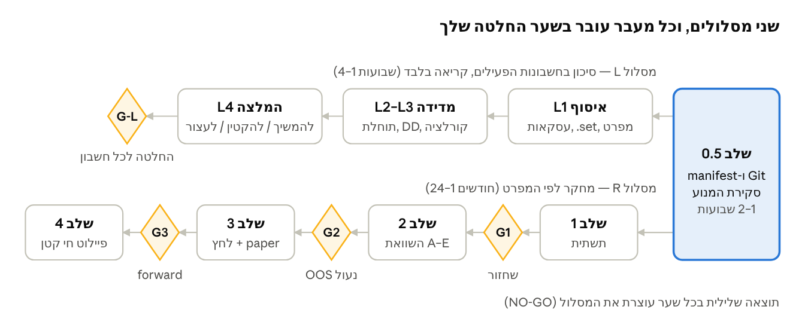

# XAUUSD — דוח שלב 0: סקירת מצב ותוכנית עבודה

תאריך: 2026-10-15 · מחבר: Claude (Opus 5.5) בהובלת הפרויקט, עבור Nadav
מקור חי (גרסה ניתנת לעריכה): [Claude Doc](https://claude.ai/code/artifact/2f3ba4a1-b0c7-420c-a283-410fdd24729a)

> הדוח נכתב לביקורת מקצועית חיצונית. כל טענה מסומנת: VERIFIED / OBSERVED / ASSUMED / UNKNOWN, וראיות מסומנות CODE / TESTED / NOT RUN.
> לא כלולים בדוח: סיסמאות, מספרי חשבון אמיתיים, כתובות שרתים.

## תוכן

1. [תקציר מנהלים](#תקציר-מנהלים)
2. [היקף ומתודולוגיה](#היקף-ומתודולוגיה)
3. [דרישות המפרט ומשמעות היעד](#דרישות-המפרט-ומשמעות-היעד)
4. [מלאי קיים (INVENTORY)](#מלאי-קיים-inventory)
5. [הערכת איכות (AUDIT BASELINE)](#הערכת-איכות-audit-baseline)
6. [ניתוח פערים (DATA GAPS)](#ניתוח-פערים-data-gaps)
7. [תוכנית עבודה (ROADMAP)](#תוכנית-עבודה-roadmap)
8. [סיכונים (RISK REGISTER)](#סיכונים-risk-register)
9. [החלטת שער 0 (DECISION 0)](#החלטת-שער-0-decision-0)
10. [שאלות פתוחות לאישור](#שאלות-פתוחות-לאישור)
11. [מקורות](#מקורות)

---

## תקציר מנהלים

**ההמלצה: CONDITIONAL GO לשלב 1 (תשתית מחקר שחזורית) בלבד, ו-NO-GO לכל פיתוח בוט חדש, לכל חיבור חי ולכל שילוב של Jev.** אין כרגע ראיה מאומתת ליתרון סטטיסטי נטו ב-XAUUSD. מה שקיים הוא כמות גדולה של מחקר קודם, נתונים ותשתית, מפוזרים בין כמה פרויקטים, ללא Git, ללא בדיקות שעוברות כאן וללא מקור אמת אחד.

ממצאים עיקריים:

1. **תיקיית הפרויקט `D:\Claude\jev` ריקה** (VERIFIED): יש בה רק קובץ הפעלה, והיא אינה מאגר Git. כל הנכסים הרלוונטיים נמצאים מחוצה לה.
2. **יש נכסי מחקר משמעותיים במחשב** (VERIFIED, לפי שמות קבצים ונפחים): 5 טרמינלי MT5 ו-MT4 אחד, היסטוריית M1 של XAUUSD מ-RoboForex-Pro לשנים 2000–2026, טיקים לחודשים 06/2025–07/2026, קוד EA ומחקר ב-Python בשני פרויקטים (`D:\Claude\money`, `D:\Ramil_claude`), ותיקיות הרצה של Strategy Tester (`C:\MT5Research`, `C:\BDR_MT5`).
3. **מנוע מסחר חמוש רץ כרגע על חשבון דמו** (VERIFIED): `ramil_live.py --arm` על חשבון RoboForex-Pro demo מאז 2026-10-08. הוא פותח "גריד" (ladder). זה מתנגש עם כלל יסוד 3 אם הגריד אינו מוגבל בחשיפה. נדרש אימות.
4. **מחקר עבר שלילי ברובו** (OBSERVED מתיעוד של סשנים קודמים, לא שוחזר כאן): הכניסה של משפחת Black Dragon/Lars נמדדה בעבר כחסרת יתרון ללא מרטינגייל (40.9% הצלחה ב-1:1). מאוחר יותר נמדדה תצורה אחרת על נתונים אחרים כרווחית בחלון של חודש אחד. התוצאה הטובה ביותר שתועדה בפרויקט Ramil היא כ-31% בשנה בכ-10% DD (p95). אף אחת מהתוצאות לא שוחזרה בסקירה הזו.
5. **יש חשבונות אמיתיים פעילים** עם EAs מבוססי מרטינגייל וגריד (OBSERVED מתיעוד קודם, לא אומת היום): בתיעוד מופיעים 8 חשבונות, הון כולל של כ-5,600 דולר אמיתיים (חשבונות סנט) ואירועי בלימה של 15%. הם מחוץ להיקף הפרויקט המקורי, אבל הם הסיכון הכספי הגדול ביותר שזוהה.
6. **Jev הוא מוצר אמיתי, אבל לא מוצר מסחר** (VERIFIED מתיעוד רשמי): מודל החלטה של TypeSafe AI שמקבל טקסט ומחזיר בחירה, ציון או הסתברות. אין לו יכולת חיזוי מחירים מוכחת, אין לו מדדי כיול מפורסמים ואין לו התייחסות לשימוש פיננסי. לכל היותר הוא מועמד לרכיב סינון בשלב 2(E).
7. **אין כיום ראיה שהיעד של $1,000 ליום בר-השגה בהון הקיים**: בהון של כ-5,600 דולר היעד (כ-250,000 דולר בשנה) מחייב תשואה של כ-4,500% בשנה. התשואה הטובה ביותר שתועדה, 31% בשנה, לא שוחזרה, ובהנחה שהיא נכונה נדרש הון של כ-800,000 דולר. אין זה חסם עליון מוכח, אבל תשואה בסדר גודל כזה מחייבת מינוף או חשיפה שהמפרט אוסר (ASSUMED).

---

## היקף ומתודולוגיה

הסקירה בוצעה ב-2026-10-15, במצב קריאה בלבד. לא נפתח אף טרמינל, לא נוצר חיבור MT5, לא נשלחה אף פקודה ולא שונה אף קובץ מחוץ לתיקיית הפרויקט.

**מה נבדק:**

- תיקיית הפרויקט `D:\Claude\jev` במלואה.
- סריקת מטא-דאטה בלבד (שמות קבצים, גדלים, תאריכים) של תיקיות הנתונים של כל טרמינלי MetaQuotes במחשב.
- קריאת תיעוד (README, קובצי סטטוס, זיכרונות של סשני Claude קודמים) בפרויקטים הקשורים.
- רשימת תהליכים רצים ומשימות מתוזמנות, וקריאת קובץ הלוג של המנוע הפעיל.
- תיעוד רשמי של Jev ב-docs.typesafe.ai וב-Cloudflare, ומקורות משניים שסומנו כלא מאומתים.

**מה הושמט במכוון:**

- קבצים שעלולים להכיל פרטי התחברות: `accounts.json`, קבצי `.env`, `*.session`, וקבצי `.ini` של טרמינלים. הם נרשמו לפי שם בלבד. את `accounts.json` שהוסף לתיקייה קראתי רק דרך סקריפט שמסתיר סיסמאות.
- קוד מקור של EAs ושל מנוע Python. סקירת קוד מלאה היא משימה של שלב 0.5.

**מגבלות:**

- אינטגריטי של קבצי ההיסטוריה של MT5 (`.hcc`, `.tkc`) לא נבדק. הפורמט קנייני ונקרא רק דרך הטרמינל או ה-API.
- מאגר BlackDragonResearch וקובץ המסירה `PROJECT.md` של פרויקט Ramil לא נמצאו בכוננים המקומיים. לפי זיכרונות קודמים הם היו תחת נתיב OneDrive. המצב שלהם UNKNOWN.
- כל מספר ביצועים שמופיע כאן ממחקר קודם מסומן OBSERVED ומצוטט מתיעוד. אף אחד מהם לא שוחזר בסקירה זו (NOT RUN).

**מפתח סימונים:**

| סימון | משמעות |
| --- | --- |
| VERIFIED | נבדק ישירות בסקירה זו (קובץ, תהליך או עמוד רשמי) |
| OBSERVED | מופיע בתיעוד או בלוג, לא שוחזר |
| ASSUMED | הנחת עבודה, מסומנת לבדיקה |
| UNKNOWN | לא ידוע, דורש אימות או מידע ממך |
| CODE / TESTED / NOT RUN | קיים כקוד / נבדק בהרצה / לא הורץ |

---

## דרישות המפרט ומשמעות היעד

המפרט מגדיר מסלול של 24–36 חודשים בארבעה שלבים עם שערי החלטה. שלב 0 עוסק בסקר נכסים והיתכנות. שלב 1 בתשתית מחקר שחזורית. שלב 2 בהשוואת אסטרטגיות A–E בתנאים זהים. שלב 3 הוא פרוטוקול ההוכחה, כולל OOS נעול ו-forward של 8–12 שבועות.

שבעה כללי יסוד חוסמים, ושניים מהם רלוונטיים ישירות לממצאים: כלל 3 (אין מרטינגייל או גריד ללא תקרה) וכלל 7 (אם אין יתרון מוכח — NO-GO).

**היעד במספרים.** ההון שנדרש להכנסה של $1,000 ליום מסחר תלוי לחלוטין בתשואה השנתית שהמערכת תשיג בפועל. החישוב מניח כ-250 ימי מסחר בשנה, כלומר כ-$250,000 לשנה, ללא צבירה (משיכה שוטפת).

| תרחיש תשואה שנתית | מקור המספר | הון נדרש (USD) | פי כמה מההון הקיים (~5,600) |
| --- | --- | --- | --- |
| 125% (0.5% ליום × 250, ללא צבירה) | יעד המחקר במפרט | 200,000 | כ-36 |
| 31% | התוצאה הטובה ביותר שתועדה בעבר (OBSERVED, לא שוחזר) | כ-806,000 | כ-144 |
| 10% | תרחיש שמרני (ASSUMED) | 2,500,000 | כ-446 |
| 0% | תרחיש אפס או שלילי: אין יתרון מוכח | אין סכום שמספיק | — |

צבירה יומית של 0.5% לאורך 250 ימים שקולה לכפל 3.48 בשנה (כ-248%). במחקר הקודם לא נמצאה אף עדות לתשואה כזו ללא מרטינגייל. תוצאות בסדר הגודל הזה נצפו רק בחלונות קצרים של מרטינגייל, שלהם זנב הפסד של עד 68% DD (OBSERVED).

**המסקנה לתכנון:** היעד משמש רק כקנה מידה לדיון על הון נדרש. הוא לא ישמש לבחירת פרמטרים, לקביעת מינוף או כקריטריון הצלחה.

---

## מלאי קיים (INVENTORY)

נמצאו שש קבוצות נכסים רלוונטיות, כולן מחוץ לתיקיית הפרויקט. הטבלאות מבוססות על מטא-דאטה בלבד (VERIFIED לקיום, UNKNOWN לתקינות).

### טרמינלים ונתוני שוק

| טרמינל | שימוש (לפי תיעוד) | נתוני זהב שנמצאו | הערות |
| --- | --- | --- | --- |
| `C:\BDR_MT5\terminal` (portable) | מחקר Black Dragon, וכעת מארח את מנוע הדמו הפעיל | RoboForex-Pro XAUUSD: טיקים 06/2025–07/2026 (1.27GB), ברים 2000–2026 (325MB); וכן XAUEUR, ו-XAUUSDc של EGlobalTrade מ-2025 | Tester: 123 קבצים, 1.17GB; 300 פרופילי Tester |
| `C:\Program Files\MetaTrader 5` | הטרמינל הראשי | RoboForex-Pro XAUUSD ברים 2000–2026 (2.75GB), MetaQuotes-Demo מ-2021, EGlobalTrade XAUUSDc | לוגים: 398MB |
| `C:\MT5Research\terminal` | סווייפים של אינדיקטורים (p13, p18) | RoboForex-Pro XAUUSD: ברים מ-2022, טיקים מ-2026 | ייצוא TrendAI/WAT ב-CSV (34MB); הסווייפים הסתיימו ב-2026-07-08 |
| `C:\Program Files\MetaTrader 5 - עותק` | עותק ישן | אין נתוני זהב | לא עודכן מאז 2025-09 |
| MT4 (`Program Files (x86)`) | בדיקות Black Dragon מוקדמות | — | `.set` של XAUUSD M1 ב-Tester |

### רובוטים (EAs) רלוונטיים

| EA | קוד מקור? | מהות (לפי תיעוד) | סטטוס ראיה |
| --- | --- | --- | --- |
| EA Black Dragon mt5 / BlackDragon_clean | לא, בינארי בלבד | מרטינגייל/גריד מסחרי | OBSERVED: רווחי בחלון אחד באחד הברוקרים, עם זנב הרסני |
| BTC Bot mt5 (Lars) | לא | מרטינגייל | OBSERVED: כניסה נקייה שלילית (40.9% ב-1:1) |
| EA Trend AI, Trend Catcher, Hamster Scalping, Umbrella, AI Gold Sniper, Equity Protect | לא | מסחריים | NOT RUN ברובם |
| RamilSignalExecutor, RamilEntryEngine v0.4 | כן (`.mq5`) | מבצע סיגנלים / מנוע כניסה | CODE |
| כ-20 EAs של ייצוא ובדיקה (HistExport, OHLCExport, Probe\*, \*Dump) | כן | כלי מחקר, לא מסחר | CODE |

### פרויקטי מחקר וקוד

| מיקום | תוכן | Git / בדיקות | סטטוס |
| --- | --- | --- | --- |
| `D:\Claude\money` | כ-180 סקריפטי Python, מנוע backtest "כן" (walk-forward, עלויות, מבחן פרמוטציות), ייצואי CSV של XAUUSDc, ומנוע המסחר `ramil_live.py` | אין Git; קבצי test קיימים (NOT RUN) | פעיל — המנוע רץ |
| `D:\Ramil_claude` | מחקר העתקת הסוחר Ramil: מסד SQLite, מודל `ramil_classifier_v1`, OCR, טלגרם | אין Git; תיקיית `tests` ריקה; `paper_trades.db` ריק (0 בתים) | עודכן לאחרונה ב-2026-07-02 |
| פרויקט Ramil המתקדם (סשן 61, `PROJECT.md`) | מערכת H4 עם executor לא חמוש | UNKNOWN | **לא נמצא בדיסק** |
| BlackDragonResearch | מנוע ניסויים מול MT5 Tester, 182 בדיקות, מסד research.db | UNKNOWN | **לא נמצא בדיסק** |
| `D:\mt5_dashboard` | דשבורד Flask למעקב חשבונות, כולל ngrok ו-`accounts.json` | אין Git; עשרות עותקים של `app*.py` | לא נבדק |
| `C:\MT5Research` | קבצי `.ini` וסקריפטים להרצת סווייפים, ארכיוני תוצאות | — | לא פעיל מאז 2026-07 |

### חשבונות וברוקרים

- **דמו RoboForex-Pro** (VERIFIED מהלוג): מנוע `ramil_live.py` חמוש עליו. היתרה ברגע החימוש ירדה מ-9,862.92 ל-9,294.54 בין הפעלה מחדש ראשונה לאחרונה, כלומר ירידה של כ-5.8% (OBSERVED). הפקדון ההתחלתי UNKNOWN.
- **חשבונות אמיתיים** (OBSERVED מזיכרונות קודמים): 8 חשבונות Black Dragon ב-RoboForex, EGlobalTrade ו-Forex4you. כולם חשבונות סנט, וההון הכולל הוא כ-5,600 דולר. מצבם הנוכחי UNKNOWN.
- **מפרטי חוזה** (tick value, swap, commission, stop level): UNKNOWN. התיעוד הקודם מציין ספרד חי של כ-$0.20 לאונקיה ב-RoboForex-Pro (OBSERVED).

### קבצים רגישים (שמות בלבד, לא נפתחו)

`D:\mt5_dashboard\accounts.json`, `D:\Ramil_claude\.env`, `D:\Ramil_claude\delta_session.session` (ככל הנראה סשן טלגרם), `~\tade_bot\real.env`, ו-`D:\Claude\jev\accounts.json`. אסור שייכנסו למאגר — כולם חסומים ב-`.gitignore`.

---

## הערכת איכות (AUDIT BASELINE)

המחקר הקודם נעשה ברמה מתודולוגית סבירה ואף גבוהה, אבל הוא אינו שחזורי במצבו הנוכחי. התיעוד של התוצאות שונה בין סשן לסשן, והתיעוד עצמו מראה שרשרת של מסקנות שנסוגו.

### טבלת ראיות — תוצאות עבר מרכזיות

| טענה ממחקר קודם | סטטוס | בעיות תקפות שזוהו |
| --- | --- | --- |
| כניסת Lars בלי מרטינגייל שלילית: 40.9% ב-1:1, כ-2,043 עסקאות | OBSERVED, NOT RUN | נבדקה על GBPUSD ובחלון של 6 חודשים. זו עדות נגד המשפחה, אבל לא על זהב. |
| תצורת `bd.set` על XAUUSDc: ‏+38.5% בחודש, PF 1.81, DD 13.3% | OBSERVED, NOT RUN | חלון אחד של כ-5 שבועות במגמה עולה. מרטינגייל 1.5 ללא SL, שאסור לפי כלל 3. פסק "החשבון החי הוא ההוכחה" מבוסס על שורד יחיד (survivorship). |
| מערכת Ramil "Base+H4": ‏755 עסקאות ב-2.5 שנים, PF holdout 1.46, כ-31% לשנה ב-DD של כ-10% (p95) | OBSERVED, NOT RUN | היא נבחרה מתוך 10 סיגנלים ועשרות ניסויים, ומספר הניסויים הכולל לא תועד, ולכן יש סיכון data snooping. 2.5 שנים במגמה עולה של הזהב. ה-forward התקיים על תצורה שונה, כלל 8 עסקאות בלבד, ונעצר ב-2026-08-11. |
| ביצוע קריאות הטלגרם של Ramil מפסיד: ‏117 עסקאות, PF 0.73 | OBSERVED | מסקנה שלילית עקבית, שנתמכת בבדיקות נוספות. |
| ICT/Kopell: אין יתרון מול כניסות אקראיות | OBSERVED | על NQ ולא על זהב, והמדגם קטן מאוד (8–28 עסקאות). |
| גריד "מכבס" יתרון כיווני: גריד מוזן סיגנל עדיף על סיגנל אקראי רק ב-35% מהמקרים | OBSERVED | מחזק את כלל 3. |

### בעיות מערכתיות שזוהו

1. **הטיית שעון**: התיעוד מציין שברי MT5 נשמרו בזמן שרת (UTC+3) כאילו הם UTC. בקבצי ה-CSV ב-`money` מופיע הסימון `+00:00`, ולכן לא ברור אם הבאג תוקן בכל הקבצים (UNKNOWN). באג דומה במחקר קודם כבר יצר יתרון שקרי (הסטת look-back של 3 שעות).
2. **ריבוי ניסויים ללא רישום**: ב-`money` יש כ-180 סקריפטים של ניסויים (sweep, final, robust, calibrated). אין רישום מרוכז של מספר ההשערות שנבדקו, ולכן אי אפשר לתקן לריבוי השוואות (Deflated Sharpe, White Reality Check).
3. **משטר שוק אחד**: הרוב המכריע של הניסויים נעשה על 2024–2026. בתקופה זו הזהב עלה מכ-$2,600 לכ-$4,400 (VERIFIED מקבצי ה-CSV). כל אסטרטגיית long או מגמה נראית טוב במשטר כזה.
4. **פיזור וחוסר עקביות**: שני מאגרים מרכזיים חסרים. אין Git בשום פרויקט. התיעוד של Ramil_claude בדיסק אינו תואם לזיכרונות של סשן 61.
5. **מנוע חמוש ללא מסמך תקפות**: המנוע הפעיל רץ עם `--no-cut`, והסף `filter` שלו מוגדר ל-`needs -9000000000`, כלומר בפועל מנוטרל (VERIFIED מהלוג). לא נמצא מסמך שמקשר בין תצורת המנוע הפעיל לתוצאת backtest מסוימת.
6. **הקונפליקט בין מנוע לטרמינל**: `mt5.initialize()` ללא נתיב עלול להתחבר לטרמינל אחר ולחשבון אחר. זה כבר קרה פעם אחת והתחבר לחשבון אמיתי במצב investor, כך שלא יכול היה לסחור (OBSERVED).

### Jev — מה מוכח ומה שיווקי

| נושא | ממצא | סטטוס |
| --- | --- | --- |
| מהות | מודל "System One" של TypeSafe AI. מקבל state ושאלות מטיפוסים noul/choice/score, ומחזיר בחירה עם הסתברויות ו-confidence. הוא לא מייצר טקסט. | VERIFIED |
| גרסאות | jev-1.13.0 (כינוי latest), ו-jev-1.14.0 (preview) מ-2026-10-14 | VERIFIED |
| מחיר | $0.042 למיליון טוקני קלט; פלט ללא תשלום. החברה עצמה אמרה שהמחיר עשוי להיות מסובסד. | VERIFIED (המחיר); יציבותו UNKNOWN |
| הקשר | 64k טוקנים לבקשה ו-32k לשאלה | VERIFIED |
| Latency | 70–500ms | שיווקי — לא מופיע בתיעוד הרשמי |
| כיול | "מאומן להחזיר החלטות מכוילות", אבל ללא מדדים מפורסמים | טענה לא מוכחת |
| נתונים מספריים / סדרות עיתיות / פיננסים | לא מוזכרים בתיעוד. קלט טקסט בלבד, והדיוק הטוב ביותר באנגלית | UNKNOWN |
| פרטיות | לא מאמן על נתוני לקוחות. ZDR רק ללקוחות Enterprise, או דרך Cloudflare. | VERIFIED |
| דטרמיניזם, SLA, מגבלות שימוש פיננסי | לא מופיעים בתיעוד | UNKNOWN |
| "בוט מסחר" על Jev | דמו של מפתח חיצוני על בורסת קריפטו ברשת, ללא נתוני ביצועים | שיווקי / אנקדוטלי |

**הערכה לגבי Jev:** מבחינת latency ועלות הוא עשוי להתאים למסחר בקצב של M15 ומעלה. אבל אין שום סיבה להניח שהוא מסוגל לחזות כיוון מחיר. השימוש הסביר היחיד הוא כמסנן (veto) על סיגנלים קיימים, כפי שהמפרט מציע ב-2(E). גם אז צריך להשוות אותו למסנן ML קלאסי זול. בנוסף, בדיקת backtest היסטורי של Jev חשופה לדליפת מידע עתידי: ייתכן שהמודל אומן על נתונים הכוללים את תקופת הבדיקה (ASSUMED — אין מקור שמאשר או שולל), ותאריך הקטיעה של נתוני האימון שלו אינו ידוע (UNKNOWN — לא נמצא בתיעוד שנסקר). לכן רק forward על נתונים מאוחרים לתאריך שחרור הגרסה נחשב לראיה נקייה.

---

## ניתוח פערים (DATA GAPS)

הפער המכריע אינו נתוני מחיר, שיש מהם הרבה. הפער הוא נתוני ביצוע אמיתיים של החשבונות הפעילים, מפרטי עלות מאומתים ומאגר מחקר אחד שניתן לשחזר.

### עדכון: המערכות הפעילות (accounts.json)

ב-2026-10-15 הוסף לתיקייה קובץ עם פרטי גישה ל-8 חשבונות. תאריך הקובץ הוא 2026-06-01, ולכן תקפות הפרטים UNKNOWN. הסיסמאות לא הועתקו. הטבלה מציגה רק מה שרשום בקובץ (VERIFIED), ללא מספרי חשבון.

| חשבון | שרת | רובוט רשום | משפחת סיכון |
| --- | --- | --- | --- |
| Black Dragon 1 | EGlobalTrade-Classic | Lars — M15, 3 ספרות | מרטינגייל/גריד |
| Black Dragon 2 | RoboForex-Pro | 1H_RAMIL | לא ידוע |
| Black Dragon 3 | RoboForex-Pro | Lars — M5, 2 ספרות | מרטינגייל/גריד |
| BTC Bot 4 | RoboForex-Pro | Lars — M15, 2 ספרות | מרטינגייל/גריד |
| Black Dragon 5 | RoboForex-Pro | Lars — M15, 2 ספרות | מרטינגייל/גריד (אירוע −508$ אמיתיים ב-2026-09-14, OBSERVED) |
| Black Dragon 6 | RoboForex-Pro | EABlackDragon Aggressive M1 | מרטינגייל אגרסיבי |
| Black Dragon 7 | RoboForex-Pro | Semmi Auto | לפי תיעוד קודם: מסחר ידני; היתרה קרסה |
| Black Dragon 8 | EGlobalTrade-Classic | Lars | מרטינגייל/גריד (הפסד ממומש של 54.7% בסגירה אחת, OBSERVED) |

הערות לטבלה:

- העמודה "משפחת סיכון" מבוססת על תיעוד קודם. התצורה הרצה בפועל על כל VPS היא UNKNOWN.
- שלושה שרתי VPS מופיעים בעמודת ההערות של הקובץ (הכתובות לא נכללו כאן).
- לא ידוע אם הסיסמאות הן סיסמאות מסחר (master) או סיסמאות צפייה (investor). לניתוח דרושות רק סיסמאות investor.

**משמעות לבקשת "לייעל":** לפי התיעוד הקודם, שישה מתוך שמונה החשבונות (1, 3, 4, 5, 6 ו-8) מריצים רובוטים ממשפחת המרטינגייל/גריד (ASSUMED — התצורה הרצה בפועל UNKNOWN). חשבון 2 מסווג "לא ידוע", וחשבון 7 מתועד כמסחר ידני. כלל יסוד 3 אוסר לייעל אותם לכיוון של יותר רווח. המחקר הקודם גם מצא שהרווח וההרס נובעים מאותו מנגנון (OBSERVED). לכן הייעול שאפשר להציע הוא ייעול סיכון:

- מדידת התוחלת הנטו האמיתית של כל חשבון, כולל הפקדות ומשיכות.
- כימות החשיפה המצטברת בכל החשבונות יחד. הנכס שבו סוחר כל חשבון (חשבון 4 נקרא "BTC Bot"), הכיוון של הפוזיציות והמתאם ביניהם הם UNKNOWN, וימדדו מהיסטוריית העסקאות והפוזיציות בשלב L3 ולא יונחו מראש.
- הצעת תקרות חשיפה ועומק גריד.
- המלצה מנומקת לכל חשבון: להמשיך, להקטין או לעצור.

### פערי נתונים ואיך לסגור אותם

| # | פער | חשיבות | איך לייצא / לאמת |
| --- | --- | --- | --- |
| 1 | היסטוריית עסקאות מלאה של 8 החשבונות | קריטי | הדרך המועדפת: בכל טרמינל VPS פותחים את לשונית History, בוחרים "All History", לוחצים קליק ימני ואז Report, ושומרים כ-HTML או XLSX. חלופה: סקריפט Python עם סיסמת investor בלבד, על טרמינל נפרד שאינו משותף עם מנוע הדמו. פער ידוע: אין עסקאות בין 09-15 ל-09-30 (OBSERVED). |
| 2 | קובצי ה-`.set` הפעילים על כל VPS | קריטי | מעתיקים מ-`MQL5\Presets` או משמירים מחלון ה-Inputs של ה-EA. שים לב: הקבצים בקידוד UTF-16. |
| 3 | מפרט חוזה לכל סימול וברוקר: גודל חוזה, ערך טיק, משיכה, עמלה, stop level, margin | קריטי | ב-MT5: Market Watch, קליק ימני על הסימול, ואז Specification. או סקריפט `symbol_info` על חיבור קריאה בלבד. |
| 4 | ספרד חי ו-slippage אמיתי | גבוה | רק מטיקים חיים ומהשוואה של מחיר מבוקש מול מחיר ביצוע בדוח העסקאות. לא מעמודת spread היסטורית. |
| 5 | אזור זמן ו-DST של שרת כל ברוקר | גבוה | משווים את שעת השרת מול UTC בשני תאריכים, מרץ ונובמבר, ומתעדים ב-manifest. |
| 6 | היסטוריית טיקים של XAUUSDc ב-EGlobalTrade | גבוה | קיימת רק מ-2025. מורידים דרך Tester על טרמינל מחקר נפרד. כ-9 דקות לחלון (OBSERVED). |
| 7 | מאגרי BlackDragonResearch ו-Ramil (סשן 61) | גבוה | נדרש ממך: היכן הם נמצאים היום (OneDrive, גיבוי או מחשב אחר). |
| 8 | לוח חדשות כלכליות עם חותמת זמן של שחרור בפועל | בינוני | לוח האירועים המובנה ב-MT5 (Calendar API) או מקור מסחרי. לא חותמת זמן של הכנסה למסד נתונים. |
| 9 | הון זמין וסבילות להפסד | קריטי | נדרש ממך. |
| 10 | גישה ל-API של Jev (מפתח, מגבלות קצב, תנאי MCA) | נמוך | נדרש רק אם נגיע לשלב 2(E). |

---

## תוכנית עבודה (ROADMAP)

התוכנית רצה בשני מסלולים מקבילים. מסלול L הוא ביקורת סיכון על החשבונות הפעילים, והוא דחוף כי כסף אמיתי נמצא בסיכון כבר עכשיו. מסלול R הוא המחקר שמגדיר המפרט. בכל שער אתה מקבל את ההחלטה, ותוצאה שלילית עוצרת את המסלול.

קריאה מימין לשמאל. מסלול L מסתיים בהחלטה שלך על כל חשבון. מסלול R מגיע לכסף אמיתי רק אחרי שלושה שערים.

### שלב 0.5 — סגירת שלב 0 (שבוע עד שבועיים)

1. יצירת מאגר Git ב-`D:\Claude\jev` עם `.gitignore` שחוסם את `accounts.json`, קבצי `.env` וקבצי `*.session`. מומלץ להעביר את `accounts.json` מחוץ לתיקייה. **(בוצע: המאגר הזה.)**
2. פיצול דוח זה ל-6 קבצים: `INVENTORY`, `AUDIT_BASELINE`, `DATA_GAPS`, `RISK_REGISTER`, `ROADMAP` ו-`DECISION_0` (כולם `.md`).
3. סקריפט מלאי שניתן להריץ מחדש. הוא מייצר manifest של כל קבצי הנתונים עם hash, טווח תאריכים ומקור.
4. סקירת קוד של `ramil_live.py` בקריאה בלבד. השאלות: מה תקרת הגריד, מה קורה בניתוק, והאם הוא עומד בכלל 3.

### מסלול L — ייעול סיכון במערכות הפעילות (שבועות 1–4, קריאה בלבד)

1. **L1 — איסוף:** היסטוריית עסקאות מלאה, קובץ `.set` פעיל ומפרט חוזה לכל חשבון (פערים 1–3). לא פותחים טרמינל מקומי בלי תוכנית למנוע הדמו.
2. **L2 — מדידה לכל חשבון:** תוחלת נטו למחזור גריד, תשואה אחרי הפקדות ומשיכות, max equity DD, מספר הפעלות של בלימת 15% ומחירן, עומק גריד מקסימלי, ומרחק ההרס (תנועה נגדית באחוזים שמפילה את החשבון).
3. **L3 — מדידה ברמת תיק:** קורלציית רווח והפסד בין החשבונות, וחשיפה מצטברת לכל סימול בנפרד (נומינל בדולרים, כיוון, וסיכון למרחק ההרס), כולל כל נכס שאינו זהב אם יימצא. תרחישי לחץ מופעלים לכל סימול **בשני הכיוונים**: גאפ של ±3%, תנועה של ±10% ב-48 שעות (ובסימול תנודתי יותר, כמו BTC, תנועה מותאמת לתנודתיות שלו), ושיבושי 2026-07-30 ו-2026-09-14 כפי שאירעו.
4. **L4 — המלצה לכל חשבון:** להמשיך כמו שהוא, להקטין גודל ועומק, או לעצור ולמשוך. כל המלצה מציגה את הסיכון הצפוי במספרים.
5. **שער G-L:** אתה מחליט על כל חשבון בנפרד. שינוי בחשבון חי מבוצע רק באישור מפורש נפרד (כלל 1). שינוי שמגדיל חשיפה לא יוצע.

### מסלול R — מחקר לפי המפרט

1. **שלב 1 — תשתית (חודשים 1–3):** מודולים נפרדים: ingestion עם נרמול אזור זמן ו-DST, מודל עלויות מלא (עלות חסרה היא שגיאה ולא אפס), בדיקות איכות נתונים, רישום ניסויים שסופר כל השערה, מנוע backtest ו-Risk Engine עצמאי. מנצלים מהקוד הקיים ב-`money/backtest` רק אחרי סקירה ובדיקות.
    1. **שער G1:** שחזור עצמאי של תוצאת עבר אחת, למשל מערכת Base+H4, מנתונים גולמיים ובפקודה אחת. **מעבר:** התוחלת נטו לעסקה בשחזור נמצאת בטווח ±10% מהתוצאה המקורית, ומספר העסקאות בטווח ±5%. **בנוסף, התאמה ברמת העסקה:** לפחות 90% מהעסקאות המקוריות מותאמות לעסקה משוחזרת (אותו כיוון, זמן כניסה ויציאה בהפרש של עד בר אחד, מחיר בהפרש של עד 2 ספרדים ו-PnL בהפרש של עד 10%), והמתאם בין סדרות התשואה היומיות של המקור והשחזור הוא לפחות 0.95. הסבילויות נרשמות מראש, ופלט הייחוס נשמר עם hash. **פער קביל:** רק פער שמקורו מתועד (הבדל בנתונים, בעלויות או באזור הזמן) ושתיקונו מחזיר את התוצאה לתוך הספים. **כישלון:** אם אחרי שבועיים הפער לא נסגר כך, G1 נכשל, ומסלול R לא עובר לשלב 2 עד שתשתית השחזור מתוקנת. הסבר שאינו סוגר את הפער אינו מספיק למעבר.
2. **שלב 2 — השוואה (חודשים 3–9):** מסמך רישום מוקדם לפני כל ריצה. הוא מגדיר השערות, features, labels, עלויות ותקופות, וקובע תקרה של עד 50 תצורות לכל משפחה. **הפרדת OOS:** בחירת התצורה נעשית רק על train/validation (walk-forward עם purging ו-embargo). ה-OOS הנעול נפתח פעם אחת בלבד, לתצורה אחת לכל משפחה שנבחרה ונרשמה לפני הפתיחה, והתוצאה סופית. אם התצורה נכשלת ב-OOS, המשפחה נכשלת. כל ניסיון נוסף באותה משפחה מחייב holdout חדש שלא נצפה, כלומר נתונים שייאספו קדימה מאותו יום. המשפחות נבחנות בסדר הזה: A (הרובוטים הקיימים), B (חוקים פשוטים), C (ML קלאסי כמסנן), ו-E (שילובים). Jev (משפחה D) נכנס רק כמסנן, במצב forward בלבד.
    1. **שער G2:** תוחלת נטו חיובית ב-OOS הנעול, כשה-CI של block bootstrap ברמת 95% אינו כולל אפס. על התוצאה לעקוף כניסות אקראיות באותה גיאומטריה (p<0.05) ואת ה-baseline. **ה-baseline** מוגדר ברישום המוקדם לפני פתיחת ה-OOS, ויש שניים: buy-and-hold של XAUUSD באותה חשיפה ממוצעת ובאותן עלויות, והגרסה הפשוטה ביותר של אותה משפחה (למשל חוק בלי מסנן). **יחידת ההשוואה:** האסטרטגיה וכל baseline מומרים לסדרה משותפת של תשואות יומיות נטו (mark-to-market) לאורך כל תקופת ה-OOS. ההשוואה נעשית על סדרת ההפרשים היומיים: ה-CI של ממוצע ההפרש וה-CI של הפרש ה-Sharpe (block bootstrap, 95%) חייבים להיות מעל אפס מול שני ה-baselines. השוואה ברמת עסקה נעשית רק מול כניסות אקראיות ומול הגרסה הפשוטה, שיש להן מדגם עסקאות. **משטרי שוק** מוגדרים מראש בכללים מכניים, מחושבים רק על נתוני עבר (lag של יום), ונקבעים לפני פתיחת ה-OOS: (1) **תנודתיות:** ATR יומי של 20 יום מעל או מתחת לחציון של תקופת ה-train; (2) **כיוון:** סימן התשואה של 60 הימים הקודמים (עולה / יורד). **קריטריון לכל משטר:** בכל אחד מארבעת המשטרים (תנודתיות גבוהה, נמוכה, כיוון עולה, יורד) נדרשות לפחות 30 עסקאות ותוחלת נטו שאינה שלילית, ובמשטר הכיוון היורד התוחלת חייבת להיות חיובית. אם ב-OOS אין משטר יורד עם 30 עסקאות לפחות, G2 **לא עובר** והתוצאה מוגדרת "לא הוכרעה" עד שיצטברו נתוני forward מספיקים, כי כל תקופת המחקר הקודמת הייתה מגמת עלייה. Deflated Sharpe Ratio (הסתברות בתחום 0–1) של לפחות 0.95, כשמספר הניסויים בחישוב הוא כל התצורות שנבדקו בכל המשפחות לפי רישום הניסויים, ולא רק במשפחה הנבחרת. נדרשות לפחות 200 עסקאות OOS, בשני משטרי שוק לפחות. המספרים הם הצעה לאישורך.
3. **שלב 3 — הוכחה (חודשים 7–12):** תרחישי לחץ, הזרקת תקלות ל-Risk Engine (ניתוק, הפעלה מחדש, פקודה כפולה), ואז paper על דמו למשך 8–12 שבועות ולפחות 100 עסקאות.
    1. **שער G3:** כל התנאים נקבעים ונרשמים לפני תחילת ה-forward. **ביצועים:** התוחלת נטו לעסקה ב-forward אינה נמוכה מהאחוזון ה-5 של התפלגות ה-bootstrap של ה-OOS, ונשארת חיובית. ה-max DD אינו עולה על פי 1.5 מהאחוזון ה-95 של DD ב-OOS. החלקה ועלויות בפועל בתוך ±25% מהמודל. **סיכון:** ה-Risk Engine עובר את כל תרחישי ההזרקה ברשימה הרשומה (ניתוק, הפעלה מחדש באמצע עסקה, פקודה כפולה, חריגה מגבול יומי, נתון חסר או מאוחר, חשבון שגוי), וכל אחד מהם נתפס ונעצר. **כישלון:** הפרה של תנאי אחד = G3 נכשל ואין מעבר לפיילוט חי. אסור להאריך את תקופת ה-forward כדי "לחכות לשיפור".
4. **שלב 4 — פיילוט חי קטן (חודשים 13–24):** רק אם עברנו את G3, ורק באישור מפורש.

### גבולות סיכון ראשוניים — הצעה בלבד, לא מופעלים

| גבול | הצעה שמרנית | נימוק |
| --- | --- | --- |
| סיכון לעסקה | 0.25%–0.5% מה-equity | שרידות ברצף של 20 הפסדים |
| הפסד יומי / שבועי | 1.5% / 3% — עצירה עד סוף התקופה | הפרדת יום רע מהרס |
| DD שוטף | עצירה ובדיקה ב-8% | רחוק מתקרת החירום |
| תקרת חירום | 15% (הקיימת) — סגירת הכול ועצירה ידנית | לפי המפרט |
| חשיפת זהב כוללת | עד 3 פוזיציות, סיכון מצטבר עד 1.5% | מניעת גריד מוסווה |
| מסנן ספרד | אין כניסה מעל 2× החציון של 20 הימים האחרונים | חדשות ונזילות |
| Heartbeat | אם אין דופק במשך 5 דקות: התראה; במשך 15 דקות: SL בצד הברוקר חייב להיות קיים | ההגנה לא תלויה בתהליך המקומי |

---

## סיכונים (RISK REGISTER)

| # | סיכון | חומרה | סבירות | מענה מוצע |
| --- | --- | --- | --- | --- |
| R1 | הפסד אמיתי בחשבונות המרטינגייל הפעילים במהלך תנועה חדה בזהב. המתאם בין החשבונות UNKNOWN וימדד ב-L3 | גבוהה | גבוהה (שני אירועים ב-2026, OBSERVED) | מסלול L. לא מגדילים חשיפה עד שער G-L |
| R2 | דליפת פרטי התחברות: `accounts.json` בתיקיית הפרויקט, ודשבורד עם ngrok ב-`D:\mt5_dashboard` | גבוהה | בינונית | להעביר את הקובץ למיקום מחוץ למאגר, `.gitignore` (בוצע), להשתמש בסיסמאות investor בלבד לניתוח, ולשקול החלפת סיסמאות שנחשפו |
| R3 | מנוע הדמו מתחבר בטעות לטרמינל אחר או לחשבון אמיתי (`initialize()` ללא נתיב) | גבוהה | קרה בעבר | בדיקת login לפני כל פקודה. עד אז לא פותחים טרמינל נוסף במחשב |
| R4 | הגנות המנוע הפעיל חיות בתהליך מקומי. כבר היה מקרה של הפסקה של שעתיים בעקבות עדכון Windows | בינונית (דמו) | גבוהה | המנוע מופעל עם `--broker-sl`. יש לאמת שכל פוזיציה נושאת SL בצד השרת |
| R5 | יתרון שקרי שנוצר מ-data snooping, מהטיית שעון או ממשטר שוק אחד | גבוהה | גבוהה (קרה לפחות פעמיים בעבר) | רישום מוקדם, ספירת ניסויים, OOS נעול, בקרת כניסות אקראיות |
| R6 | עלויות בפועל גבוהות מהמודל (ספרד שמתרחב בחדשות, משיכות) | בינונית | בינונית | עלויות מנתוני ביצוע חיים, ותרחיש לחץ של עלות כפולה |
| R7 | תלות ב-Jev: מחיר מסובסד, גרסאות שמתחלפות, אין SLA | נמוכה כרגע | — | נעילת גרסה (לא latest). המערכת חייבת לעבוד גם בלעדיו |
| R8 | לחץ להגיע ל-$1,000 ליום מוביל להגדלת מינוף | גבוהה | בינונית | היעד משמש רק לחישוב הון נדרש. המינוף נקבע לפי DD ב-p95 של bootstrap |
| R9 | אובדן מחקר קודם כי המאגרים לא נמצאו | בינונית | קיים | שאלה 1 למטה |

---

## החלטת שער 0 (DECISION 0)

**CONDITIONAL GO** לשלב 0.5, למסלול L (קריאה בלבד) ולשלב 1 (תשתית). **NO-GO** לפיתוח בוט או אסטרטגיה חדשה, לכל שינוי בחשבון חי ולשילוב Jev.

הנימוק: אין יתרון מוכח ושחזורי. הרווח שנצפה בחשבונות החיים נובע ממנגנון שהמפרט אוסר. מנגד, הנתונים והתשתית שכבר קיימים מספיקים כדי לבנות מערך מחקר תקין בעלות נמוכה. על שלושה תנאים להתקיים: תשובות לשאלות 1–3, פרטי ההתחברות מוצאים מתיקיית הפרויקט, ואף פעולה לא משנה חשבון או מנוע פעיל.

---

## שאלות פתוחות לאישור

- [ ] **מאגרים חסרים:** היכן נמצאים היום BlackDragonResearch ופרויקט Ramil עם `PROJECT.md`? והאם מותר לי לקרוא את הקוד ב-`money` וב-`Ramil_claude`?
- [ ] **הון וסבילות:** כמה הון אמיתי זמין כרגע (האם עדיין כ-5,600$?), ומהו ההפסד המקסימלי שאתה מוכן לספוג בדולרים?
- [ ] **מסלול L:** האם אתה מאשר איסוף נתונים מ-8 החשבונות? הדרך המועדפת היא שתייצא דוחות מה-VPS, או שתספק סיסמאות investor. האם הסיסמאות ב-`accounts.json` הן master או investor?
- [ ] **מנוע הדמו:** להשאיר את `ramil_live.py` רץ ללא שינוי, כ-forward של משפחה A, או לעצור אותו?
- [ ] **Jev:** האם יש לך גישה ל-API? והאם מקובל עליך לשלוח נתוני שוק מסכמים (ללא פרטי חשבון) לשירות חיצוני?

---

## מקורות

- [Jev — תיעוד רשמי (TypeSafe)](https://docs.typesafe.ai)
- [Jev — דף מודלים: גרסאות, מחיר, הקשר, שימוש בנתונים](https://docs.typesafe.ai/models.md)
- [Jev — מסמכים משפטיים](https://docs.typesafe.ai/legal.md)
- [Jev — Cloudflare Workers AI](https://developers.cloudflare.com/ai/models/typesafe/jev/)
- [Jev — טענות latency משניות (welcome.ai)](https://welcome.ai/content/jev-ai-enhances-trading-automation-with-rapid-decision-making-and-cost-efficiency)
- [דמו בוט מסחר על Jev (hermes-ai.net)](https://hermes-ai.net/jev/case/2100356151468585346/)
- מקורות מקומיים: תיקיות טרמינלי MetaQuotes, `D:\Claude\money\README.md`, `results/live_run.log`, `D:\Ramil_claude\CURRENT_STATUS.md`, וזיכרונות של סשני Claude קודמים בפרויקטים BlackDragonResearch ו-Ramil.
